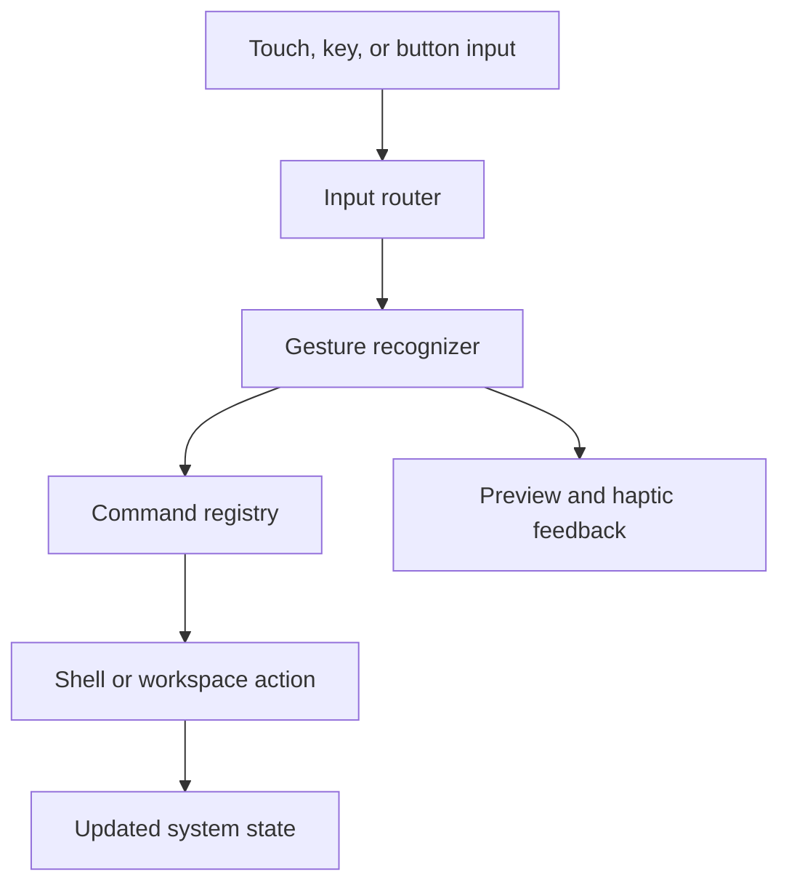

# Ferrix Mobile Interaction System

## Status

- **Stage:** Design proposal
- **Target:** Ferrix mobile shell on mainline Linux
- **Primary input:** Touchscreen
- **Secondary inputs:** Hardware buttons, external keyboard, accessibility devices
- **Implementation timing:** Future milestone after basic display, touch input, and application launching work

## Overview

Ferrix should translate Omarchy's keyboard-first philosophy into a mobile-native command system. The goal is not to reproduce desktop key combinations as arbitrary gestures. The goal is to preserve the qualities that make Omarchy fast and coherent:

- one universal command modifier;
- a small, composable command vocabulary;
- consistent system-wide behavior;
- fast access without navigating menus;
- built-in discovery and learning;
- complete keyboard support when a keyboard is connected.

The proposed mobile equivalent of `SUPER` is a persistent **Ferrix command pill** at the bottom of the display. Direct gestures handle spatial navigation. Gestures beginning on the command pill invoke commands.

> **Design principle:** Keyboard-first on desktop becomes command-first on mobile: one thumb modifier, one spatial navigation model, and every gesture discoverable through the same command surface.

## Goals

1. Make frequent actions reachable with one thumb and one continuous gesture.
2. Preserve Omarchy's launcher, command, workspace, and cheat-sheet mental models.
3. Keep the interaction vocabulary small enough to learn and remember.
4. Provide visible previews and haptic feedback before actions commit.
5. Make every gesture-accessible action available through a visible control.
6. Preserve standard keyboard bindings when an external keyboard is present.
7. Keep the command model independent of the final shell or compositor implementation.

## Non-goals

- Reproducing every Omarchy desktop binding on a touchscreen.
- Requiring multi-finger gestures for normal operation.
- Replacing application-specific controls with system gestures.
- Hiding essential actions behind undocumented gestures.
- Defining the final visual theme, animation language, or icon set.
- Defining device-specific power and volume button behavior before hardware validation.

## Interaction model

Ferrix uses three input layers.

### 1. Direct manipulation

Direct touches affect visible content. Examples include tapping controls, scrolling lists, dragging objects, and pinching content. Applications own these interactions.

### 2. Spatial navigation

System navigation gestures move between locations or application states:

- edge swipe: go back;
- swipe across the command pill: move between workspaces;
- swipe up and hold: show the workspace overview;
- two-finger workspace gesture: move the current application, where supported.

Navigation gestures should always provide an interactive preview. Reversing the gesture before release cancels the transition.

### 3. Command mode

Touching and holding the Ferrix command pill activates the equivalent of holding `SUPER`:

1. The current surface scales back slightly.
2. A contextual command layer appears.
3. Dragging highlights commands under the thumb.
4. Haptic ticks indicate activation and selection boundaries.
5. Releasing executes the highlighted command.
6. Returning to the command pill cancels the operation.

Holding without dragging opens the complete command sheet.

## Initial gesture map

This is a proposed default map. Validate it through prototypes before treating it as a stable interface contract.

| Input | Action | Omarchy concept |
| --- | --- | --- |
| Tap command pill | Go home | Show desktop/home |
| Swipe up from command pill | Open launcher and command palette | `SUPER + SPACE` |
| Hold command pill | Open contextual command sheet | `SUPER + K` |
| Hold, drag, release | Execute radial command | `SUPER + <key>` |
| Swipe command pill left/right | Previous/next workspace | Workspace navigation |
| Swipe up and hold | Workspace overview | Window/workspace overview |
| Edge swipe inward | Back | Back/navigation action |
| Two-finger swipe left/right | Move current app between workspaces | Move active window |
| Pinch outward on an app surface | Toggle full screen | `SUPER + F` |
| Long-press power | Open system menu | `SUPER + ESCAPE` |
| Connect external keyboard | Enable native Ferrix/Omarchy bindings | Desktop keybindings |

Do not reserve hardware-button combinations until the target device behavior has been tested. Emergency calling, power controls, screenshots, accessibility shortcuts, and bootloader behavior take priority.

## Command layer

### Primary radial commands

The first prototype should contain no more than four commands:

| Direction | Default command |
| --- | --- |
| Up | Search / launcher |
| Left | Terminal |
| Right | Browser |
| Down | System menu |

These defaults should be configurable. A command may be unavailable because of lock state, application state, permissions, or missing software; unavailable commands remain visible with an explanation.

### Command sheet

Holding the command pill without selecting a radial command opens a full command sheet. The sheet is both a reference and an executable menu.

Organize commands into:

- Navigation
- Applications
- Workspaces
- Current application
- System
- Hardware buttons
- Accessibility

Each row contains:

- command name;
- gesture or keyboard binding;
- optional icon;
- availability state;
- short contextual description.

Selecting a row executes the command. This lets new users operate Ferrix visibly while experienced users learn the corresponding gesture.

### Launcher and command palette

The launcher should search across:

- installed applications;
- system commands;
- settings;
- open workspaces;
- recent files, when enabled;
- contacts and communication actions, subject to permission and lock state.

The launcher should support touch, on-screen keyboard input, hardware keyboard input, and voice input when available. Search providers must declare which data they access.

## Workspace model

Ferrix should use persistent horizontal workspaces rather than treating the icon grid as the primary home surface.

- Each workspace remembers its current application and state.
- Applications open in the active workspace by default.
- Horizontal pill gestures move between workspaces.
- The overview shows workspace previews and running state.
- Moving an application to another workspace is an explicit action.
- Landscape mode may support two tiled applications after the single-app model is stable.
- The launcher appears over the current workspace rather than navigating to a separate app grid.

The first implementation should limit workspace count to a small fixed maximum. Dynamic creation and removal can follow after navigation behavior is proven.

## System architecture

Keep the interaction contract separate from rendering and compositor internals.

### Components

| Component | Responsibility | Candidate implementation |
| --- | --- | --- |
| Input router | Normalize touch, keyboard, hardware button, and accessibility input | Rust service or compositor module |
| Gesture recognizer | Track thresholds, velocity, direction, cancellation, and gesture ownership | Rust library/service |
| Command registry | Store commands, bindings, availability, labels, and handlers | Rust service with a stable IPC interface |
| Shell surface | Render pill, overlays, launcher, overview, and command sheet | Quickshell/QML or another Wayland shell |
| Workspace controller | Query and manipulate active applications and workspaces | Compositor IPC adapter |
| Haptics adapter | Produce semantic feedback for activation, movement, and commitment | Device-specific service behind a generic interface |
| Accessibility adapter | Expose semantic actions and alternate activation paths | Shell and accessibility stack integration |
| Configuration loader | Load defaults and user overrides | Declarative configuration parsed by the command registry |

### Event flow

### Command contract

Every system command should expose the same conceptual fields, regardless of the eventual serialization format:

| Field | Purpose |
| --- | --- |
| `id` | Stable machine-readable identifier |
| `label` | Human-readable command name |
| `category` | Command-sheet grouping |
| `scope` | System-wide or contextual |
| `availability` | Whether the command can currently run |
| `disabled_reason` | Explanation when unavailable |
| `default_binding` | Gesture, keyboard binding, or hardware input |
| `handler` | Action invoked by the registry |
| `security_level` | Whether the command is allowed while locked |
| `accessibility_label` | Description exposed to assistive technology |

Do not commit to a public configuration schema until the command registry prototype proves which fields and state transitions are required.

## Gesture arbitration

System gestures and application gestures will compete for the same touch input. Resolve ownership using the following order:

1. Emergency and security-critical hardware actions
2. Accessibility shortcuts
3. Lock-screen and system-modal actions
4. Reserved system-edge gestures
5. Command-pill gestures
6. Application gestures

Additional rules:

- Begin command gestures only inside the command pill's hit region.
- Keep back navigation confined to a narrow edge region.
- Let applications opt out of nonessential system gestures while full screen.
- Never allow applications to intercept emergency or security-critical actions.
- Delay command commitment until direction and distance cross a visible threshold.
- Cancel cleanly when gesture recognition remains ambiguous.

## Accessibility and safety requirements

- Provide a visible control for every essential gesture action.
- Support keyboard-only and switch-style navigation.
- Expose semantic labels, roles, states, and actions for shell controls.
- Use sufficiently large touch targets around the command pill and command items.
- Make haptic feedback optional and never use it as the only state indicator.
- Provide visual and, where enabled, audible confirmation of destructive actions.
- Require confirmation for shutdown, restart, destructive workspace actions, and security-sensitive commands.
- Offer left-handed and right-handed radial layouts.
- Allow gesture distance, hold duration, and motion sensitivity to be adjusted.
- Provide a reduced-motion mode.
- Avoid gestures that are difficult to perform with limited dexterity.

## Security model

Commands must declare whether they can execute while the device is locked.

Examples that may be available while locked:

- emergency calling;
- camera launch, if configured;
- media controls;
- flashlight;
- viewing non-sensitive system status.

Examples that should require authentication:

- terminal access;
- file access;
- revealing notification contents;
- viewing recent documents;
- launching wallet or signing flows;
- changing network or developer settings;
- powering off when policy requires authentication.

The command palette must not leak sensitive search results onto the lock screen.

## Implementation phases

### Phase 0: Validate platform prerequisites

- [ ] Confirm reliable touchscreen events through the selected Wayland input stack.
- [ ] Confirm compositor support for workspace queries and transitions.
- [ ] Confirm the shell can reserve and render a persistent bottom surface.
- [ ] Determine whether gesture recognition belongs in the compositor, shell, or a separate service.
- [ ] Confirm haptic control on the development device.
- [ ] Document conflicts with existing system, bootloader, and hardware-button behavior.

**Exit criteria:** Raw touch events, a visible command pill, and one test action work reliably on the development device.

### Phase 1: Command pill prototype

- [ ] Render the command pill above a test application.
- [ ] Implement tap, hold, drag, release, and cancel states.
- [ ] Add visible activation and selection thresholds.
- [ ] Add mock haptic events or device haptics when available.
- [ ] Implement the four-command radial prototype.
- [ ] Record gesture latency, cancellation rate, and accidental activation rate.

**Exit criteria:** A user can invoke all four commands one-handed and cancel a selection without leaving the current application.

### Phase 2: Command registry

- [ ] Define stable internal command identifiers.
- [ ] Register system and application-launch commands.
- [ ] Add contextual availability and disabled reasons.
- [ ] Route keyboard and touch bindings through the same registry.
- [ ] Add lock-state policy checks.
- [ ] Add structured logs for command invocation and failure.

**Exit criteria:** The same command can be invoked through the pill, command sheet, and external keyboard without duplicating action logic.

### Phase 3: Discoverability surfaces

- [ ] Implement the executable command sheet.
- [ ] Group commands by scope and category.
- [ ] Show current touch and keyboard bindings.
- [ ] Add search across registered commands and applications.
- [ ] Add a first-run interactive gesture tutorial.
- [ ] Add a reset-to-defaults path.

**Exit criteria:** A new user can discover and execute every core system action without knowing any gesture in advance.

### Phase 4: Workspace navigation

- [ ] Implement previous/next workspace gestures.
- [ ] Add interactive transition previews and cancellation.
- [ ] Implement the workspace overview.
- [ ] Preserve application state across workspace changes.
- [ ] Add an explicit move-to-workspace action.
- [ ] Test portrait and landscape behavior.

**Exit criteria:** Workspace navigation remains stable across application launch, rotation, suspend, resume, and application failure.

### Phase 5: Accessibility and input parity

- [ ] Expose semantic shell actions to the accessibility stack.
- [ ] Verify keyboard-only operation.
- [ ] Add left-handed layout support.
- [ ] Add hold-duration and gesture-distance settings.
- [ ] Add reduced-motion and haptic controls.
- [ ] Test with screen reading and switch-style input where supported.
- [ ] Audit all essential gestures for visible alternatives.

**Exit criteria:** Every essential action has at least one non-gesture activation path.

### Phase 6: Device integration and hardening

- [ ] Map hardware-button behavior on the target device.
- [ ] Validate lock-screen command policies.
- [ ] Test calls, alarms, notifications, and emergency flows during overlays.
- [ ] Test false activation while walking, typing, gaming, and rotating the device.
- [ ] Measure input-to-preview and input-to-action latency.
- [ ] Add crash recovery for the shell and command service.
- [ ] Document recovery behavior when the compositor or shell becomes unavailable.

**Exit criteria:** Core navigation and emergency functions remain usable after shell restart, application crash, suspend/resume, and orientation changes.

## Prototype test matrix

| Scenario | Expected result |
| --- | --- |
| Short tap on pill | Home action occurs once |
| Hold without movement | Command sheet opens |
| Hold and drag to command | Selection previews before release |
| Drag back to origin | Command cancels |
| Fast horizontal pill swipe | Workspace changes |
| Partial workspace swipe | Transition follows the finger and can reverse |
| App uses horizontal scrolling | App retains gesture unless input began on reserved system region |
| Device is locked | Restricted commands remain unavailable and explain why |
| External keyboard connects | Keyboard bindings invoke the same registered commands |
| Haptics disabled | All states remain understandable visually |
| Shell restarts | Current application survives where compositor support permits |

## Usability metrics

Measure the prototype against explicit targets. Set numeric thresholds after the first device baseline rather than inventing them in advance.

- time to launch a common application;
- time to switch workspaces;
- accidental command activations;
- cancelled or misclassified gestures;
- percentage of commands discovered without instruction;
- one-handed completion rate;
- input-to-preview latency;
- input-to-action latency;
- successful completion using keyboard-only navigation;
- successful completion with haptics and animation disabled.

## Open decisions

- Should the pill be rendered by the compositor or the shell?
- Should gesture recognition run inside the compositor or in an isolated Rust service?
- Can applications hide the pill, or only reduce its visual prominence?
- How many persistent workspaces should the initial release support?
- Should the radial commands be fixed, user-configurable, or context-dependent?
- How should terminal access behave on the lock screen and in restricted modes?
- Which accessibility stack is practical on the selected mobile Linux base?
- Which haptic capabilities are exposed by the OnePlus development hardware and the eventual Solana Seeker target?
- How should wallet and signing surfaces interrupt or suppress global command gestures?
- Which standard Omarchy keybindings remain appropriate when a hardware keyboard is connected?

## Recommended first implementation slice

Build only the smallest vertical slice needed to validate the interaction model:

1. Render a persistent command pill in the Wayland shell.
2. Recognize tap, hold, drag, release, and cancel.
3. Display four radial command targets.
4. Route those targets through a minimal Rust command registry.
5. Implement Home, Launcher, Terminal, and System Menu as prototype commands.
6. Provide the same four actions in a visible command sheet.
7. Bind the equivalent external-keyboard shortcuts through the same registry.
8. Test one-handed use, accidental activation, cancellation, and latency on physical hardware.

Do not implement workspace movement, dynamic radial commands, extensive customization, or complex multi-finger gestures until this slice feels reliable.

## Definition of done

The Ferrix mobile interaction system is ready for broader integration when:

- the command pill behaves consistently across core applications;
- common actions work through touch, visible menus, and a hardware keyboard;
- gestures provide previews, cancellation, and appropriate feedback;
- workspace navigation is stable through suspend, resume, and rotation;
- lock-state restrictions prevent sensitive data and commands from leaking;
- essential actions remain usable without gestures;
- shell failure does not prevent emergency or recovery actions;
- the binding configuration and command registry are documented and testable;
- the interaction model has been validated on physical mobile hardware.
